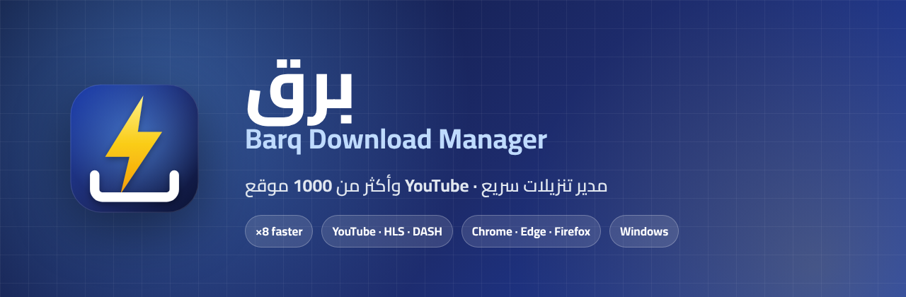
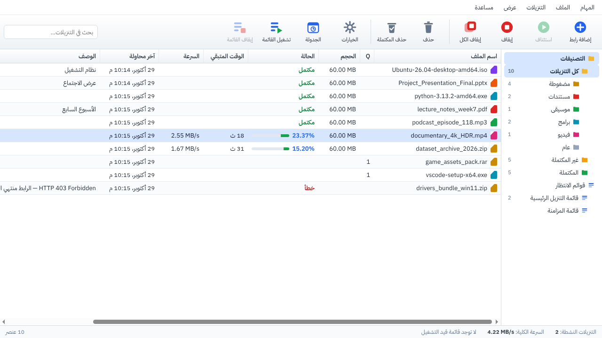
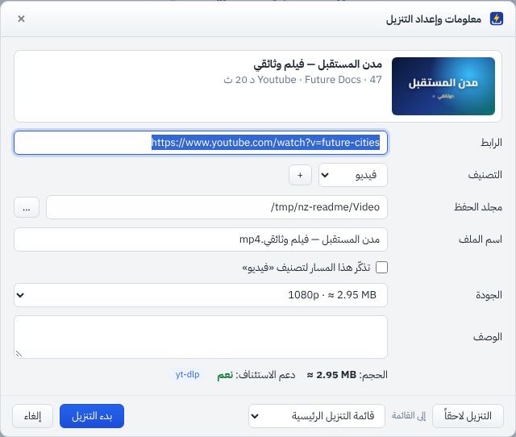
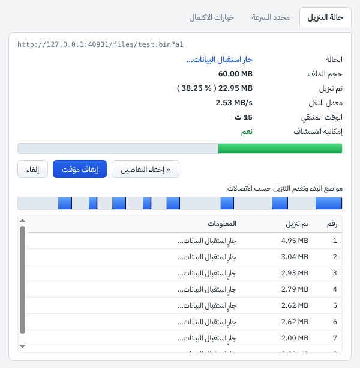
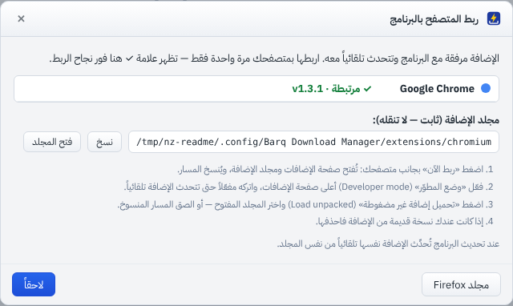
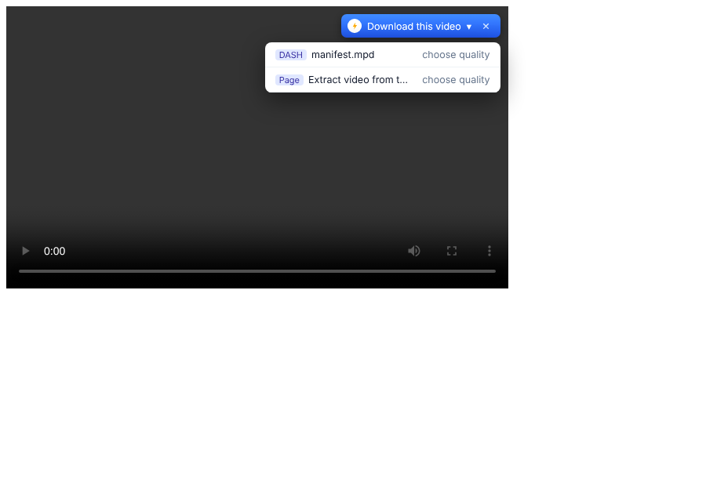
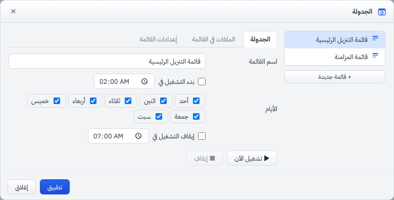
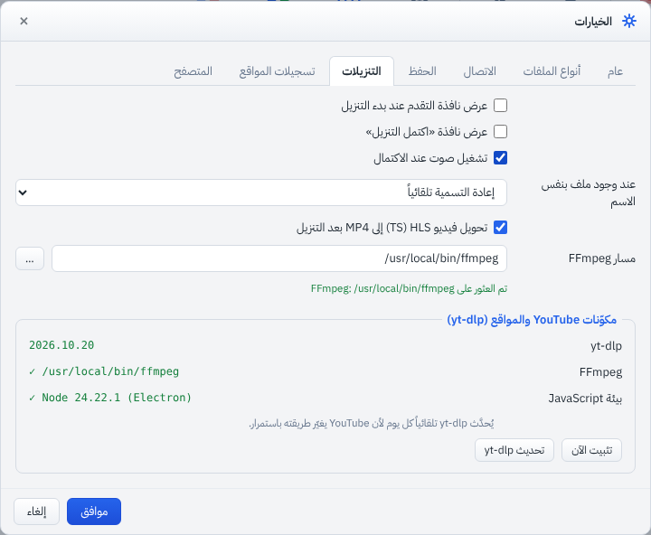
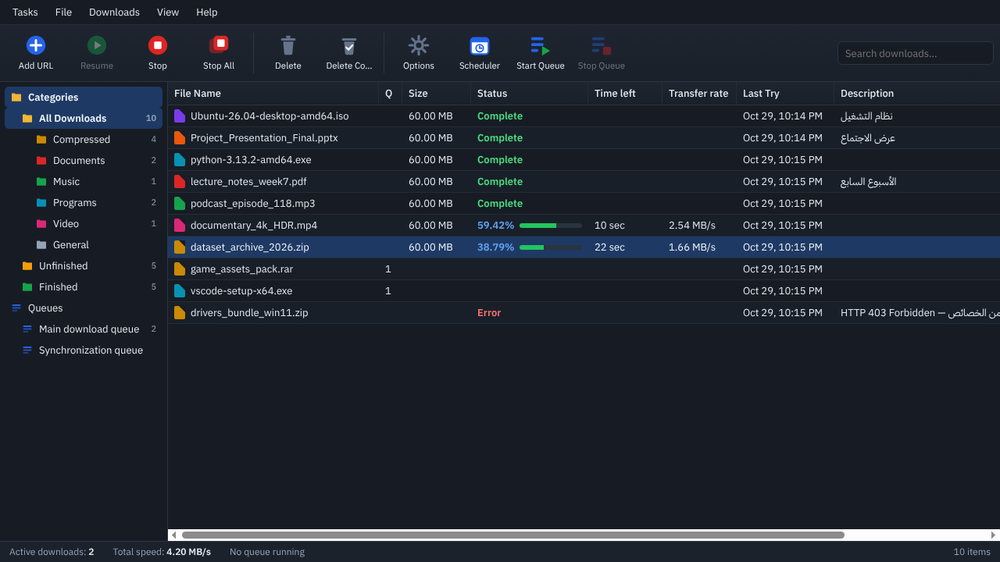

<p align="center"></p>

<p align="center">
  <a href="../../releases/latest"></a>
  
  
  
</p>

<p align="center"><b><a href="#ar">العربية</a> · <a href="#en">English</a></b></p>

---

<div dir="rtl" id="ar">

## ⚡ برق — مدير تنزيلات سريع

**برق** مدير تنزيلات لسطح المكتب. يقسم الملف ديناميكياً وينزّله عبر عدة اتصالات معاً، فيصل إلى سرعة أعلى بعدة أضعاف من التنزيل العادي. يدعم **YouTube وأكثر من 1000 موقع**، وبث HLS وDASH، ويأتي مع إضافة لكل المتصفحات.

<p align="center"></p>

### ✨ الميزات

| | |
|---|---|
| 🚀 **تسريع حقيقي** | تقطيع ديناميكي حتى 32 اتصالاً، وعدد اتصالات يتكيّف مع الخادم، واستبدال الاتصال البطيء، والتنزيل من عدة مصادر (Mirrors) |
| ▶️ **YouTube و+1000 موقع** | X وInstagram وTikTok وFacebook وVimeo وغيرها، بجودة تصل إلى 4K، أو صوت فقط MP3/M4A، أو قوائم تشغيل كاملة |
| 🎬 **بث HLS وDASH** | اختيار الجودة، وفك تشفير AES-128، ودمج الصوت والصورة تلقائياً في ملف MP4 |
| ⏯️ **استئناف موثوق** | يكمل من حيث توقف، حتى بعد إغلاق البرنامج أو انقطاع الإنترنت |
| 🧩 **إضافة لكل المتصفحات** | Chrome وEdge وBrave وOpera وVivaldi وFirefox، مع زر «تنزيل هذا الفيديو» فوق المشغلات، وتتحدث تلقائياً مع البرنامج |
| 🗓️ **قوائم انتظار وجدولة** | أوقات بدء وإيقاف، وأيام محددة، وإغلاق البرنامج أو الجهاز عند الانتهاء |
| 🌙 **واجهة عربية وإنجليزية** | مظهر فاتح وداكن، ويبدأ مع ويندوز مخفياً بجانب الساعة |
| 🛡️ **أدوات إضافية** | التحقق من بصمة الملف (SHA-256/MD5)، وفحص المساحة قبل التنزيل، ومحدد سرعة، وسطر أوامر بصيغة IDM |

### 🖼️ صور

| تنزيل من YouTube | نافذة التقدم |
|---|---|
|  |  |
| **ربط المتصفح بالبرنامج** | **لوحة الفيديو في المتصفح** |
|  |  |
| **الجدولة وقوائم الانتظار** | **الخيارات والمكوّنات** |
|  |  |

<p align="center"><br><sub>المظهر الداكن بالواجهة الإنجليزية</sub></p>

### 📥 التثبيت

1. حمّل **`Barq-Setup.exe`** من صفحة **[الإصدارات](../../releases/latest)**، أو النسخة المحمولة **`Barq-Portable.exe`** التي تعمل بلا تثبيت.
2. شغّل البرنامج. تظهر نافذة **«ربط المتصفح بالبرنامج»**: اضغط «ربط الآن» بجانب متصفحك، ثم اتبع الخطوات الثلاث.
3. عند أول تنزيل من YouTube، ينزّل البرنامج مكوّنَي yt-dlp وFFmpeg تلقائياً.

> ملفات التثبيت غير موقّعة رقمياً، لذا قد يحذّر ويندوز (SmartScreen) عند التشغيل. اختر «مزيد من المعلومات» ثم «تشغيل على أي حال».

### 📊 التسريع بالأرقام

قيس التسريع على خوادم تحاكي ظروفاً واقعية، وطابقت بصمة SHA-256 للملف في كل الحالات (`npm run bench`):

| السيناريو | قبل | بعد | التسريع |
|---|---|---|---|
| خادم يحدّ كل اتصال بـ 1 MB/s | 1.00 MB/s | **8.36 MB/s** | **×8.4** |
| اتصالان على عقدة CDN بطيئة | 1.89 MB/s | **8.85 MB/s** | **×4.7** |
| ملف متاح من خادمين (Mirrors) | 3.03 MB/s | **6.05 MB/s** | **×2.0** |

### ⚠️ ما لا يمكن تنزيله

المحتوى المحمي بنظام **DRM** (Netflix وShahid وDisney+ وPrime Video) مشفّر، ولا يمكن لأي برنامج تنزيل نظامي تنزيله.

</div>

---

<div id="en">

## ⚡ Barq — a fast download manager

**Barq** (Arabic for *lightning*) is a desktop download manager with dynamic multi-connection segmentation, **YouTube and 1000+ sites** support, HLS/DASH streaming, and a browser extension for every major browser.

### Features

- **Real acceleration:**
  - Dynamic segmentation with up to 32 connections.
  - Adaptive connection count with 429/503 back-off.
  - Slow-connection replacement and end-game splitting.
  - Multi-mirror downloading.
  - DNS cache and Happy Eyeballs.
- **YouTube & 1000+ sites** via [yt-dlp]:
  - Quality picker up to 4K, audio-only MP3/M4A, and whole playlists.
  - Uses Electron's built-in Node as the JavaScript runtime YouTube now requires.
  - Browser cookies are passed through.
- **HLS & DASH:** quality selection, AES-128 decryption, and automatic audio/video muxing with FFmpeg.
- **Reliable resume:** byte offsets are stored in [Realm] after every pause, crash, or restart.
- **Browser extension** (Chrome, Edge, Brave, Opera, Vivaldi, Firefox):
  - Download interception, context menus, and a floating "Download this video" button.
  - Captures media in iframes and request headers.
  - Updates itself together with the app.
- **Queues & scheduler, speed limiter, checksum verification, disk-space check, IDM-style CLI** (`Barq.exe /d URL /p dir /f name /n /q /s`).
- **Arabic (RTL) and English UI**, with light and dark themes. Starts with Windows, hidden in the tray.

### Install

Download **`Barq-Setup.exe`** (or the portable build) from **[Releases](../../releases/latest)**, run it, and follow the *Connect your browser* wizard.

### Build from source

```bash
npm install          # Electron + Realm
npm start            # run
npm test             # engine, manager/Realm, DASH and yt-dlp test suites
npm run bench        # speed benchmark
npm run dist:win     # Windows installer + portable exe → release/
```

Pushing a tag such as `v1.3.1` builds the Windows installer on GitHub Actions and attaches it to a Release automatically. See `.github/workflows/release.yml`.

### Architecture

```
src/main/       Electron main process (Node)
  engine.js     segmented HTTP engine, resume, HLS, limiter, adaptive connections
  dash.js       MPEG-DASH parser + downloader
  ytdlp.js      yt-dlp integration, auto-installed components
  manager.js    queues, scheduler, categories
  db.js         Realm schema (automatic fallback store if the native module is missing)
  bridge.js     127.0.0.1 bridge for the browser extension
src/renderer/   UI — plain HTML/CSS/JS, no framework
extension/      Manifest V3 extension (Chromium + Firefox build via scripts/pack-extensions.js)
test/           local test servers, simulators and test suites
```

### Not supported

DRM-protected streams (Netflix, Disney+, Prime Video, Shahid…) are encrypted and cannot be downloaded by any legitimate downloader.

### Credits & license

Built with [Electron], [Realm], [yt-dlp] (Unlicense), and [FFmpeg] (downloaded on first use, GPL). The fonts are IBM Plex Sans Arabic and Cairo, both under the OFL.

Released under the [MIT License](LICENSE).

[Electron]: https://www.electronjs.org
[Realm]: https://github.com/realm/realm-js
[yt-dlp]: https://github.com/yt-dlp/yt-dlp
[FFmpeg]: https://ffmpeg.org

</div>
